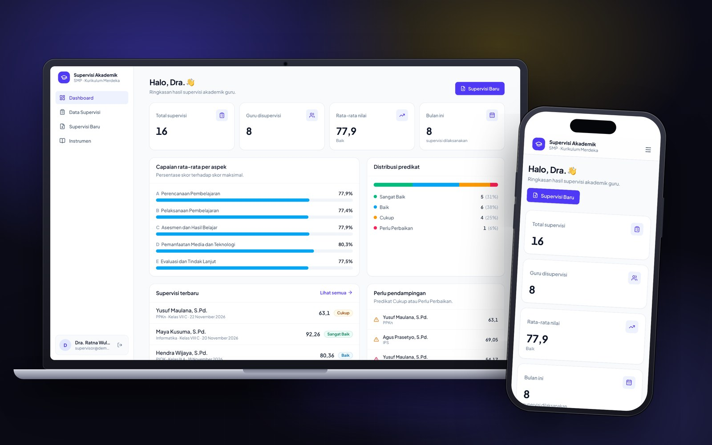
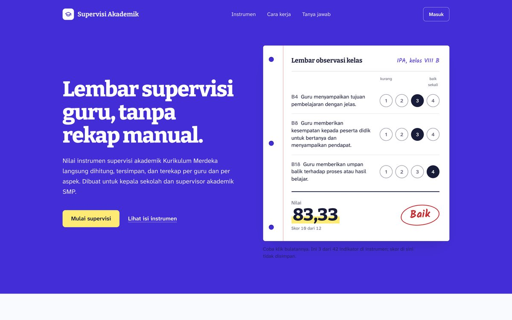
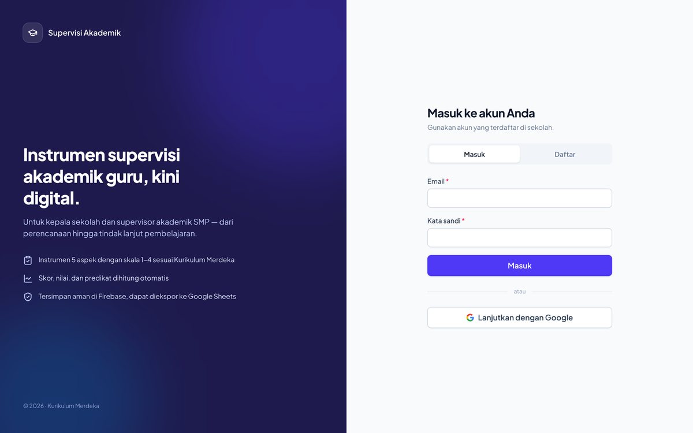
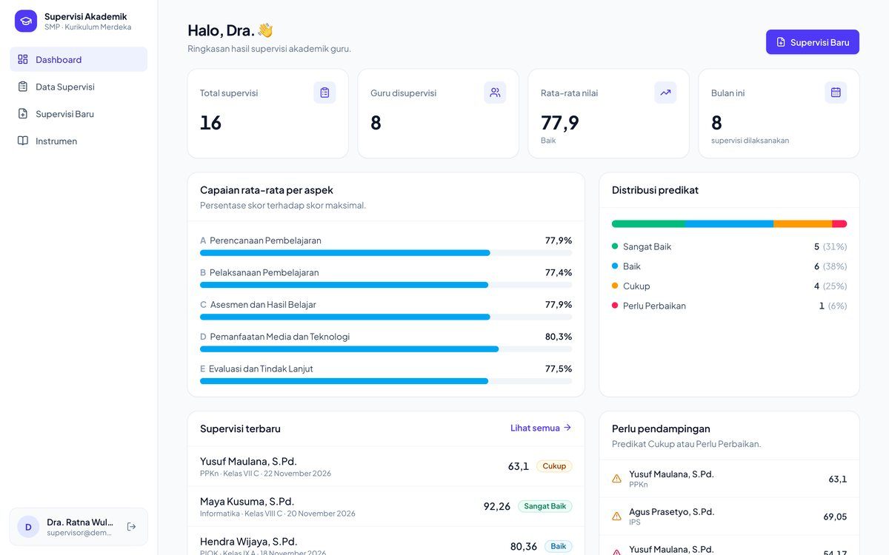
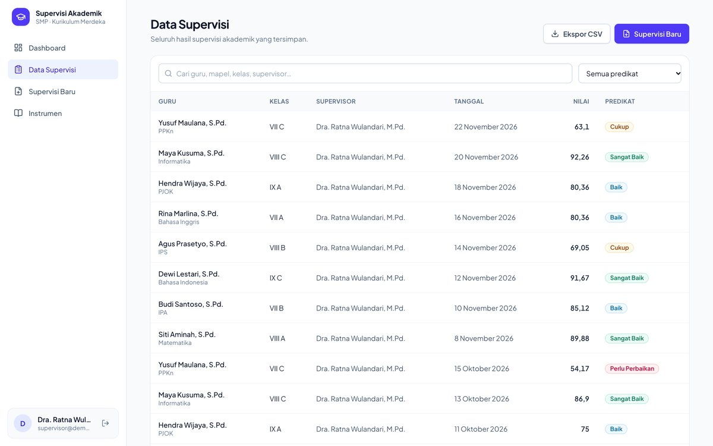
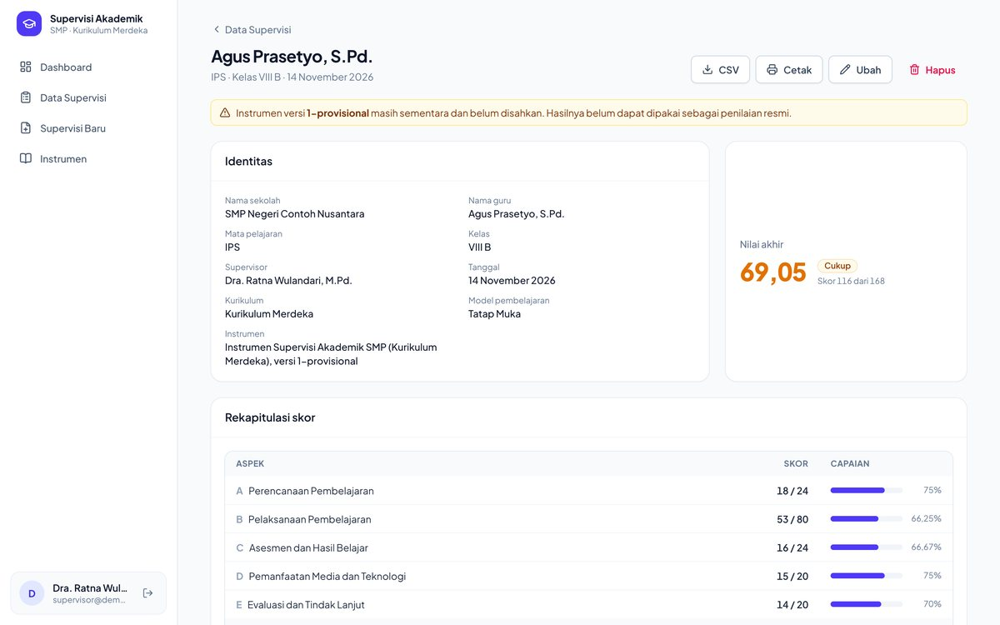
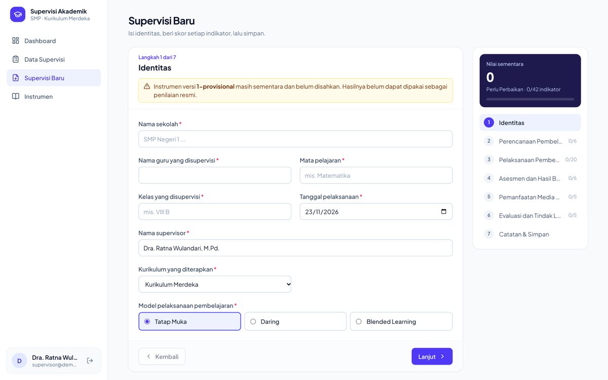
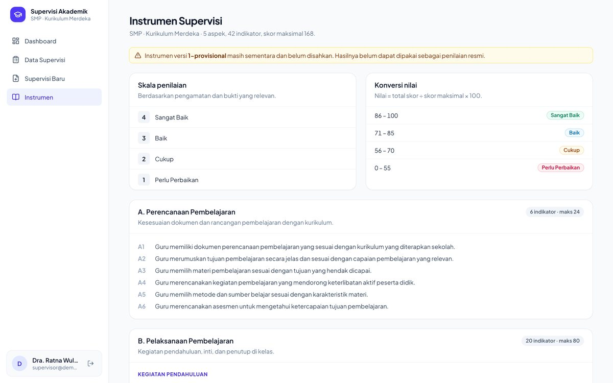
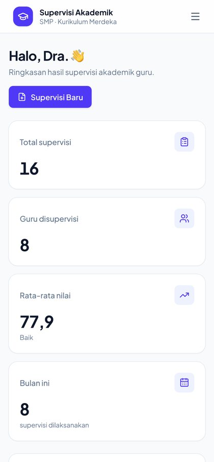
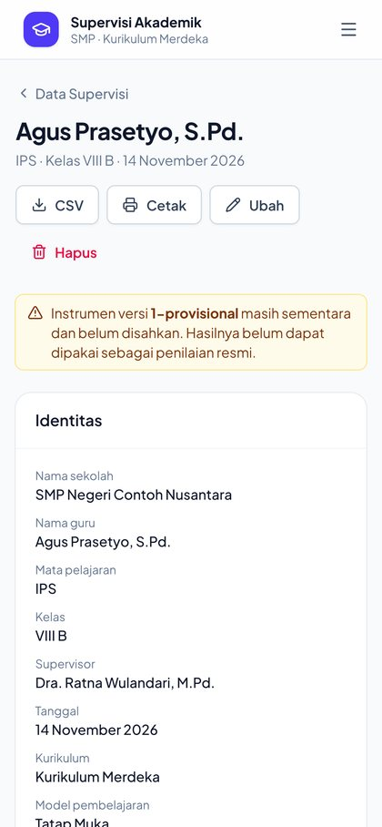

<div align="right">

[English](README.md) · **Bahasa Indonesia**

</div>

# Instrumen Supervisi Akademik Guru



[](https://react.dev)
[](https://www.typescriptlang.org)
[](https://vite.dev)
[](https://firebase.google.com)
[](LICENSE)

Aplikasi web yang mendigitalkan **supervisi akademik guru** SMP (*Kurikulum Merdeka*). Kepala sekolah atau supervisor mengamati kelas, memberi skor pada 42 indikator dalam 5 aspek dengan skala 1 sampai 4, lalu aplikasi menghitung nilai, predikat, dan rincian per aspek, menyimpannya, dan dapat mengekspornya. Aplikasi ini dibuat sebagai proyek untuk keperluan akademik mahasiswa.

Antarmuka berbahasa Indonesia. Demo: [instrument-pengajaran.vercel.app](https://instrument-pengajaran.vercel.app) (perlu masuk).

> **Status instrumen:** instrumen bawaan (versi `1-provisional`) adalah draf kerja. Indikator dan ambang predikatnya masih harus dicocokkan dengan instrumen resmi sebelum hasilnya dipakai sebagai penilaian formal. Aplikasi menampilkan peringatan ini di setiap tempat skor muncul.

## Fitur

- **Form bertahap:** identitas, lima aspek (skala 1 sampai 4), lalu catatan dan rekomendasi. Draf tersimpan otomatis di browser.
- **Penilaian otomatis:** total, nilai akhir (0 sampai 100), predikat, dan skor per aspek dihitung saat form diisi.
- **Dashboard:** rata-rata nilai, capaian per aspek, distribusi predikat, dan guru yang perlu pendampingan.
- **Data supervisi:** pencarian dan filter, detail, ubah, hapus, **cetak A4**, dan **ekspor CSV** (siap untuk Google Sheets).
- **Versi instrumen:** setiap data menyimpan salinan instrumen yang dipakai saat penilaian, sehingga perubahan instrumen di kemudian hari tidak mengubah hasil lama.
- **Ramah koneksi buruk:** cache Firestore untuk sekolah dengan koneksi tidak stabil.
- **Masuk:** email dan kata sandi, atau Google (Firebase Authentication).

## Tangkapan layar

Semua tangkapan layar memakai **data demo fiktif** (sekolah, guru, dan supervisor rekaan).

| Beranda | Masuk |
|---|---|
|  |  |

| Dashboard | Data supervisi |
|---|---|
|  |  |

| Detail | Supervisi baru |
|---|---|
|  |  |

| Instrumen | Mobile |
|---|---|
|  |   |

## Teknologi

| Bagian | Teknologi |
|---|---|
| UI | React 19, TypeScript, Tailwind CSS 4, Vite 8 |
| Routing dan data | React Router, TanStack Query |
| Form dan validasi | React Hook Form, Zod |
| Backend | Firebase Authentication dan Cloud Firestore |
| Pengujian | Vitest (penilaian, CSV, pemetaan, dan data instrumen) |

## Memulai

### Opsi A: emulator lokal (tanpa akun Firebase)

```bash
npm install
npm run emulators        # terminal 1: emulator Auth dan Firestore
npm run seed:emulator    # terminal 2: data demo fiktif
npm run dev:emulator     # terminal 3: http://localhost:5173
```

Masuk dengan `supervisor@demo.test` / `Demo12345!`. Skrip seed hanya menulis ke emulator lokal. Emulator Firestore membutuhkan Java.

### Opsi B: project Firebase sendiri

```bash
npm install
cp .env.example .env.local   # isi dengan konfigurasi Web App Firebase
npm run dev
```

1. Buat project Firebase dan Web app, lalu salin konfigurasinya ke `.env.local`.
2. Aktifkan **Authentication → Sign-in method → Email/Password** (dan **Google** bila diperlukan).
3. Buat database Firestore dan deploy aturannya: `firebase deploy --only firestore:rules`.
4. Tambahkan domain produksi di **Authentication → Settings → Authorized domains**.

Skrip lain: `npm run build` · `npm run typecheck` · `npm run lint` · `npm test`

### Catatan keamanan

Aturan bawaan di [firestore.rules](firestore.rules) mengizinkan **setiap pengguna yang sudah masuk membaca semua data**, sedangkan ubah dan hapus hanya untuk pembuat data. Bila pendaftaran dibuka, siapa pun yang mendaftar dapat membaca seluruh data. Batasi pendaftaran atau perketat aturan sebelum menyimpan data guru yang sebenarnya.

## Model data

Satu dokumen per supervisi di koleksi `supervisi`:

| Field | Isi |
|---|---|
| `identitas` | sekolah, guru, mapel, kelas, supervisor, tanggal, kurikulum, model pembelajaran |
| `skor` | id indikator ke skor 1 sampai 4 (mis. `A1`, `B12`) |
| `catatanAspek`, `catatan` | catatan per aspek; kekuatan, perbaikan, rekomendasi |
| `instrumen`, `versiInstrumen` | salinan instrumen yang dipakai |
| `ringkasan` | total, nilai akhir (0 sampai 100), predikat, skor per aspek |
| `createdBy`, `createdByName`, `createdAt`, `updatedAt` | metadata |

Predikat dari nilai akhir (skor ÷ skor maksimal × 100): **≥ 86 Sangat Baik · ≥ 71 Baik · ≥ 56 Cukup · < 56 Perlu Perbaikan**. Ambang ada di [src/lib/scoring.ts](src/lib/scoring.ts); indikatornya di [src/data/instrumen-v1.ts](src/data/instrumen-v1.ts).

## Struktur repositori

```text
.
├── src/
│   ├── data/          Definisi instrumen, versi, dan tipe
│   ├── features/      auth, supervisi (form, mapper, CSV, query), landing
│   ├── lib/           Setup Firebase, penilaian
│   ├── routes/        Halaman (dashboard, daftar, form, detail, instrumen)
│   └── components/    Komponen UI dan layout
├── scripts/           Skrip seed untuk emulator lokal
├── firestore.rules    Aturan keamanan
└── docs/screenshots/  Gambar untuk README
```

## Lisensi

Dirilis di bawah [Lisensi MIT](LICENSE).

## Penulis

**Rizky Eka Haryadi**  
[GitHub](https://github.com/Rizky28eka) · [LinkedIn](https://www.linkedin.com/in/rizky28eka/) · [Portofolio](https://heyeka.vercel.app/projects/instrumen-supervisi)
