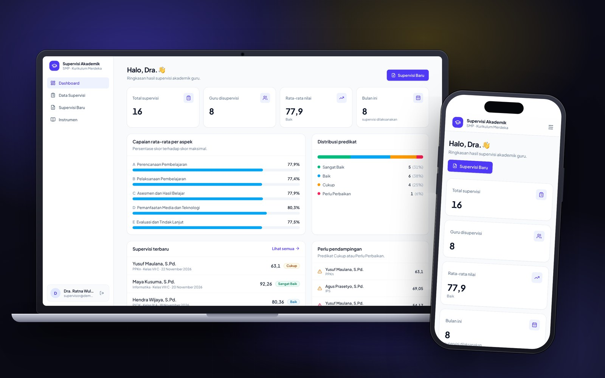
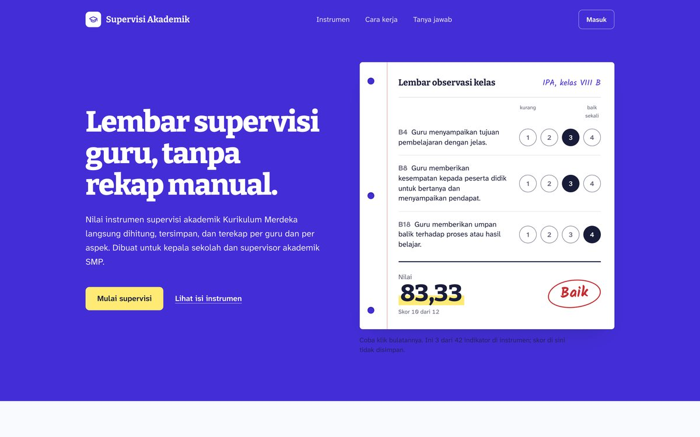
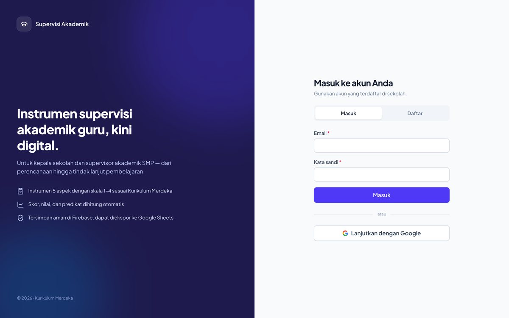
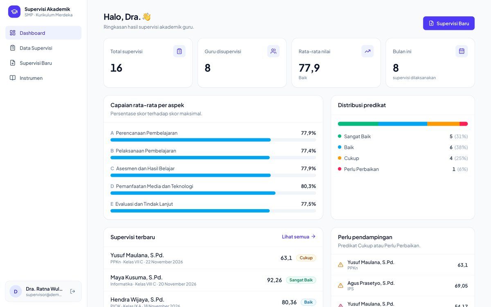
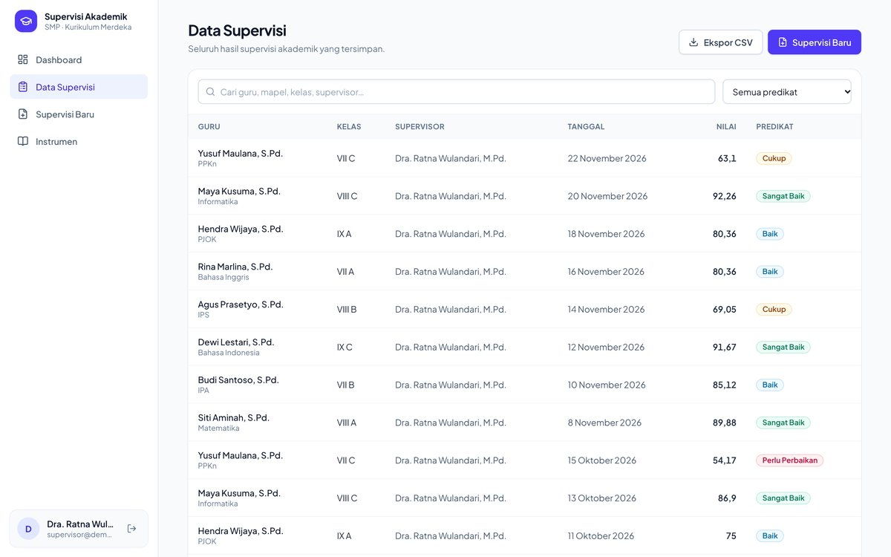
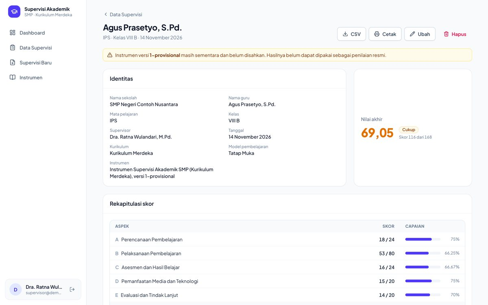
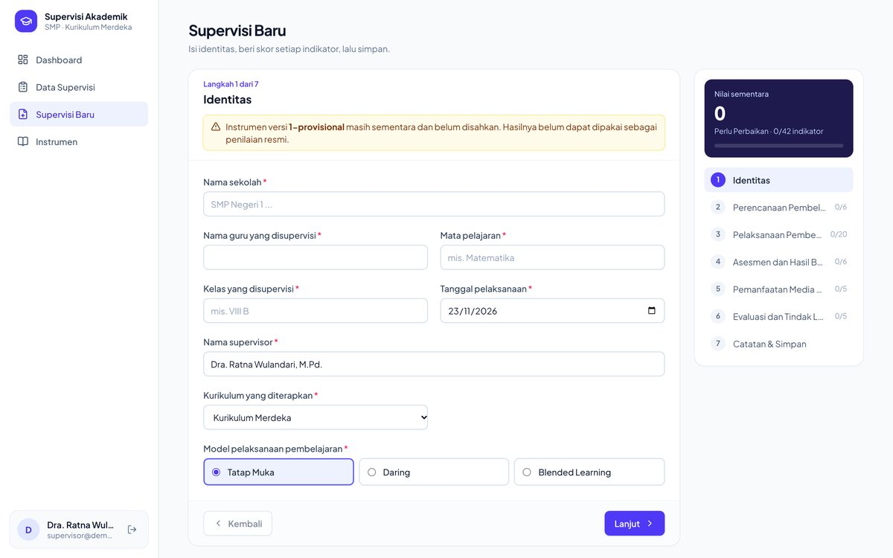
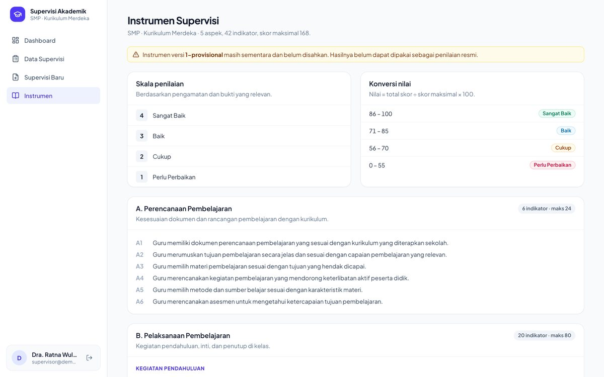
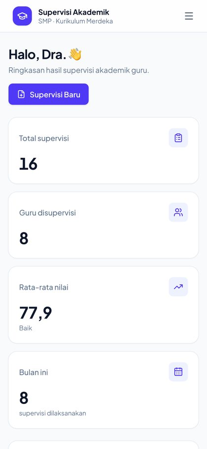
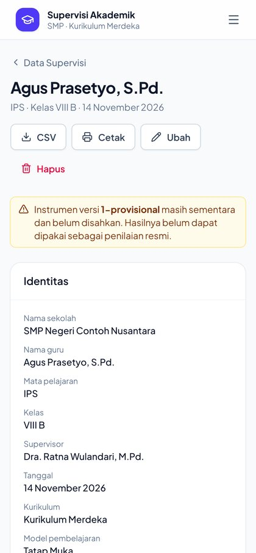

<div align="right">

**English** · [Bahasa Indonesia](README.id.md)

</div>

# Academic Supervision Instrument for Teachers



[](https://react.dev)
[](https://www.typescriptlang.org)
[](https://vite.dev)
[](https://firebase.google.com)
[](LICENSE)

A web app that digitises **academic supervision of teachers** in Indonesian junior high schools (SMP, *Kurikulum Merdeka*). A principal or academic supervisor observes a class, scores 42 indicators across 5 aspects on a 1 to 4 scale, and the app computes the score, the predicate and the per-aspect breakdown, stores everything, and exports it. It was built as a project for a college student's academic needs.

The interface is in Indonesian. Live demo: [instrument-pengajaran.vercel.app](https://instrument-pengajaran.vercel.app) (sign in required).

> **Status of the instrument:** the bundled instrument (version `1-provisional`) is a working draft. Its indicators and thresholds still have to be confirmed against the official instrument before the results are used as a formal assessment. The app shows this notice wherever scores appear.

## Features

- **Step-by-step form:** identity, five aspects (scale 1 to 4), then notes and recommendations. Drafts are saved automatically in the browser.
- **Automatic scoring:** total, final score (0 to 100), predicate and per-aspect score are calculated as you fill in the form.
- **Dashboard:** average score, achievement per aspect, predicate distribution, and teachers who need coaching.
- **Records:** search and filter, detail view, edit, delete, **A4 print** and **CSV export** (ready for Google Sheets).
- **Instrument versioning:** each record keeps a snapshot of the instrument it was scored with, so later edits to the instrument never change old results.
- **Offline-friendly:** Firestore cache for schools with unstable connections.
- **Sign-in:** email and password, or Google (Firebase Authentication).

## Screenshots

All screenshots use **fictional demo data** (a made-up school, teachers and supervisor).

| Landing | Sign in |
|---|---|
|  |  |

| Dashboard | Records |
|---|---|
|  |  |

| Record detail | New supervision |
|---|---|
|  |  |

| Instrument | Mobile |
|---|---|
|  |   |

## Tech stack

| Area | Technology |
|---|---|
| UI | React 19, TypeScript, Tailwind CSS 4, Vite 8 |
| Routing and data | React Router, TanStack Query |
| Forms and validation | React Hook Form, Zod |
| Backend | Firebase Authentication and Cloud Firestore |
| Tests | Vitest (scoring, CSV, mapping and instrument data) |

## Getting started

### Option A: local emulators (no Firebase account needed)

```bash
npm install
npm run emulators        # terminal 1: Auth and Firestore emulators
npm run seed:emulator    # terminal 2: fictional demo data
npm run dev:emulator     # terminal 3: http://localhost:5173
```

Sign in with `supervisor@demo.test` / `Demo12345!`. The seed script only writes to the local emulator. It needs Java for the Firestore emulator.

### Option B: your own Firebase project

```bash
npm install
cp .env.example .env.local   # fill in your Firebase Web App config
npm run dev
```

1. Create a Firebase project and a Web app, then copy its config into `.env.local`.
2. Enable **Authentication → Sign-in method → Email/Password** (and **Google** if you want it).
3. Create a Firestore database and deploy the rules: `firebase deploy --only firestore:rules`.
4. Add your production domain under **Authentication → Settings → Authorized domains**.

Other scripts: `npm run build` · `npm run typecheck` · `npm run lint` · `npm test`

### Security note

The default rules in [firestore.rules](firestore.rules) let **any signed-in user read all records**, and only the creator edit or delete their own. If sign-up is open, that means anyone who registers can read every record. Restrict registration or tighten the rules before storing real teacher data.

## Data model

One document per supervision in the `supervisi` collection:

| Field | Content |
|---|---|
| `identitas` | school, teacher, subject, class, supervisor, date, curriculum, learning model |
| `skor` | indicator id to score 1 to 4 (for example `A1`, `B12`) |
| `catatanAspek`, `catatan` | notes per aspect; strengths, improvements, recommendations |
| `instrumen`, `versiInstrumen` | snapshot of the instrument used |
| `ringkasan` | total, final score (0 to 100), predicate, score per aspect |
| `createdBy`, `createdByName`, `createdAt`, `updatedAt` | metadata |

Predicate from the final score (score ÷ maximum × 100): **≥ 86 Sangat Baik · ≥ 71 Baik · ≥ 56 Cukup · < 56 Perlu Perbaikan**. Thresholds live in [src/lib/scoring.ts](src/lib/scoring.ts); the indicators are in [src/data/instrumen-v1.ts](src/data/instrumen-v1.ts).

## Repository structure

```text
.
├── src/
│   ├── data/          Instrument definition, versions and types
│   ├── features/      auth, supervisi (form, mapper, CSV, queries), landing
│   ├── lib/           Firebase setup, scoring
│   ├── routes/        Pages (dashboard, list, form, detail, instrument)
│   └── components/    UI primitives and layout
├── scripts/           Seed script for the local emulator
├── firestore.rules    Security rules
└── docs/screenshots/  Images used in this README
```

## License

Released under the [MIT License](LICENSE).

## Author

**Rizky Eka Haryadi**  
[GitHub](https://github.com/Rizky28eka) · [LinkedIn](https://www.linkedin.com/in/rizky28eka/) · [Portfolio](https://heyeka.vercel.app/projects/instrumen-supervisi)
